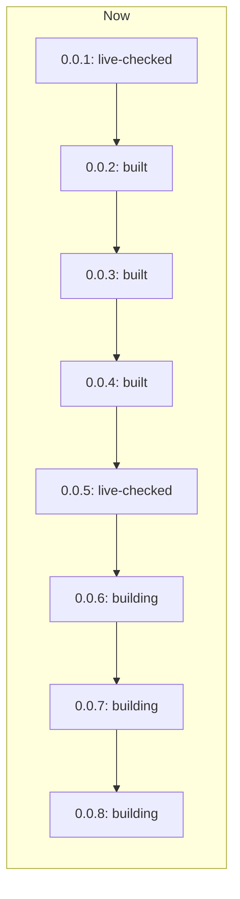

# OpenWiz roadmap

**Private. Themes, not specs.** Only the next version is ever grilled and specced (lesson 6, ADR 0006); everything below it is one line, revisited each time a version is accepted. Status: **confirmed by Jake, 2026-10-31** ("confirm that fr now"). Decided: 0.0.7's direction; the rest are directions and candidates, not decisions. See `docs/grills/2026-10-31-roadmap.md`.

## What OpenWiz is

**You decide, agents do.** One place where Jake approves plans and answers questions, while fleets of agents across all his projects do the work; later his personal agents (dot) drive it too. Three layers (the 0.0.0 design): the **coding factory** (fleets that build, review and merge), the **controller** (one authority for state, permissions and memory) and the **personal agents** (dot and others, through PACP). We build from the bottom up. Jake uses the GUI; agents use the CLI.

**Where it lives (Jake, 2026-10-31):** OpenWiz runs on the user's always-on machine and connects to every agent they use (personal agents, CloudRoom, Claude desktop and any coding agent), not to CloudRoom alone. Which version starts this isn't decided ([private record](https://github.com/jparker2006/ClosedWiz/issues/2299#issuecomment-6765399493)).

**For now (Jake, 2026-10-31):** Keep developing OpenWiz as a hobby open-source project on top of CloudRoom; consider turning it into a product once it is good ([private record](https://github.com/jparker2006/ClosedWiz/issues/2299#issuecomment-6765399493)).

**Moving work between machines (Jake, 2026-10-31):** CloudRoom's machine handoff integration is inadequate even though switching manually is easy. Handing a thread or a job from one machine to another (the Mac, the home PC, the Cloud) is OpenWiz's to build; until then Jake copies threads by hand. Not yet in a version ([private record](https://github.com/jparker2006/ClosedWiz/issues/2299#issuecomment-6765399493)).

## Where we are

Written from GitHub's milestones by `tools/roadmap/roadmap.py`: edit the milestones, never the table or the picture.

<!-- roadmap:now-next:begin -->
| Horizon | Version | State | You can … | Done when … | Links |
| --- | --- | --- | --- | --- | --- |
| Now | 0.0.1 | live-checked | You can list and inspect your CloudRoom threads from the terminal. | Done when the quick live check on the Mac passes (#4). | [milestone](https://github.com/jparker2006/ClosedWiz/milestone/7) · live check [#4](https://github.com/jparker2006/ClosedWiz/issues/4) |
| Now | 0.0.2 | built | You can see the same list as a private web page on your phone. | Done when the live check on the Mac and the phone passes (#7). | [milestone](https://github.com/jparker2006/ClosedWiz/milestone/8) · live check [#7](https://github.com/jparker2006/ClosedWiz/issues/7) |
| Now | 0.0.3 | built | You can send a message to a thread, from the terminal and the phone. | Done when the live delivery test passes (#10). | [milestone](https://github.com/jparker2006/ClosedWiz/milestone/9) · live check [#10](https://github.com/jparker2006/ClosedWiz/issues/10) |
| Now | 0.0.4 | built | You can start new threads and attach files, from the terminal and the phone. | Done when the live check of both passes (#13). | [milestone](https://github.com/jparker2006/ClosedWiz/milestone/10) · live check [#13](https://github.com/jparker2006/ClosedWiz/issues/13) |
| Now | 0.0.5 | live-checked | You can run fleets of agents from eight skills, in any harness. | Done when a real fleet builds 0.0.6 with these skills (#106). | [milestone](https://github.com/jparker2006/ClosedWiz/milestone/1) · spec [#95](https://github.com/jparker2006/ClosedWiz/issues/95) · live check [#106](https://github.com/jparker2006/ClosedWiz/issues/106) · [grill](grills/2026-10-30-fleets-0.0.5.md) |
| Now | 0.0.6 | building | You can see and run fleets inside OpenWiz itself, and watch them on the fleets screen. | Done when a real fleet runs on OpenWiz's own tick (#130). | [milestone](https://github.com/jparker2006/ClosedWiz/milestone/2) · spec [#107](https://github.com/jparker2006/ClosedWiz/issues/107) · spec [#116](https://github.com/jparker2006/ClosedWiz/issues/116) · spec [#123](https://github.com/jparker2006/ClosedWiz/issues/123) · live check [#130](https://github.com/jparker2006/ClosedWiz/issues/130) · [grill](grills/2026-10-30-0.0.6.md) |
| Now | 0.0.7 | building | You can have helper swarms speed up building and reviewing, with five new skills: wayfind, where-are-we, image, research and diagnose. | Done when 0.0.7's acceptance passes (#236). | [milestone](https://github.com/jparker2006/ClosedWiz/milestone/4) · spec [#203](https://github.com/jparker2006/ClosedWiz/issues/203) · spec [#205](https://github.com/jparker2006/ClosedWiz/issues/205) · live check [#236](https://github.com/jparker2006/ClosedWiz/issues/236) · [grill](grills/2026-10-31-0.0.7.md) |
| Now | 0.0.8 | building | You can close your Mac for good: OpenWiz runs itself on your PC. | Done when the Mac stays shut for a whole day and the fleets keep building and merging (#275). | [milestone](https://github.com/jparker2006/ClosedWiz/milestone/6) · spec [#262](https://github.com/jparker2006/ClosedWiz/issues/262) · live check [#275](https://github.com/jparker2006/ClosedWiz/issues/275) |
<!-- roadmap:now-next:end -->

<!-- roadmap:picture:begin -->

<!-- roadmap:picture:end -->

## Next (one line each; order being grilled)

- **0.0.7 — Swarms and new skills (decided direction):** helper swarms on top of `build-ticket` and `review-ticket`, sized by how hard a PR is, plus wayfind and the other small skills moved out of 0.0.5 and 0.0.6 (Jake, 2026-10-31). The original direction also included skill polishing; Jake moved that work to the polish version, now 0.0.X, on 2026-11-01 ([private record](https://github.com/jparker2006/ClosedWiz/issues/2299#issuecomment-6765399493)).
- **Loops inside OpenWiz — a future version, to grill (direction, Jake, 2026-11-01):** the software factory combines a well-organized graph with many loops. Which loops OpenWiz runs over ClosedWiz (today's are CloudRoom loops: the fleet tick, the orchestrator's PR watcher, one-shot merges) gets its own grill, starting from the SF1 loop docs ([private record](https://github.com/jparker2006/ClosedWiz/issues/2299#issuecomment-6765399493)).
- **The retro loop — far later (SF2 territory):** a loop that constantly improves the factory; Jake placed it with the much later dream-cycle work, beyond the basics ([private record](https://github.com/jparker2006/ClosedWiz/issues/2299#issuecomment-6765399493)).
- **The always-on home PC (decided, 2026-10-31, see `docs/grills/2026-10-31-versions.md`):** right after 0.0.6 is live, OpenWiz's loop (the tick) and the phone server move to Jake's always-on PC, as one small step, not a whole version. ClosedWiz's CI moves there now (#139), so CI costs nothing.
- **Many projects:** a second project's fleets live; one view across every project; cost and capacity.
- **General direction, not a decision (Jake, 2026-10-31):** keep building toward an always-on OpenWiz controller on Jake's home PC that runs every project's fleets with nobody babysitting; Jake decides from his phone; agents use the CLI. 0.1.0 remains undecided ([private record](https://github.com/jparker2006/ClosedWiz/issues/2299#issuecomment-6765399493)).
- **dot drives it (a candidate):** approve plans and answer "Needs you" from dot (the first PACP).
- **SF2 territory:** learned decisions (Jev), specialised roles, memory research, context-rot detection ("Context Lens").

## After 0.0.7 (confirmed directions, round 3)

- **0.0.X — polish, whenever it fits (was 0.0.8; Jake, 2026-11-01):** polish has no fixed version number and is not urgent. It includes the UI design pass done hands-on, the repo tidied (older code checked for loose JSON readers, duplicate schema checkers merged, stale docs fixed, flaky tests hardened), and a clean public README and install, including the skills; plus skill polish (spec #204, moved from 0.0.7): Jake reads each of the eight skills with the orchestrator and his notes become edits ([private record](https://github.com/jparker2006/ClosedWiz/issues/2299#issuecomment-6765399493)).
- **Publishing never waits:** each version is published as soon as it passes its live check; Jake specified that finished versions such as 0.0.3 and 0.0.4 do not wait. Grills and private notes never go public ([private record](https://github.com/jparker2006/ClosedWiz/issues/2299#issuecomment-6765399493)).
- **Polish stays, without a fixed number** (Jake retained polish; now 0.0.X, not urgent). 0.0.8 is open for what the system needs most ([private record](https://github.com/jparker2006/ClosedWiz/issues/2299#issuecomment-6765399493)).
- **0.0.8 — close the Mac for good (confirmed, 2026-11-01, see `docs/grills/2026-11-01-0.0.8.md`):** the PC's CloudRoom becomes the hub; OpenWiz runs there as an always-on service (its tick, web page and phone server), with health checks that restart what died, its own GitHub App, and a web page showing every thread on the PC, whatever machine it runs on; the Mac becomes one of the PC's machines. Done when the Mac stays closed for a whole day and the fleets keep building and merging, with nobody restarting anything. The orchestrator moves to the PC before it, as a handoff.
- **After 0.0.8, the destination (direction):** any machine runs threads on any other, threads move between machines (CloudRoom's teleport only moves between local and cloud on one machine, so Jake chose to build OpenWiz's own handoff), and OpenWiz picks the machine, so Jake runs whole fleets from the web without knowing where they run ([private record](https://github.com/jparker2006/ClosedWiz/issues/2299#issuecomment-6765399493)).
- **Then one view of all your projects,** once a second project runs fleets.
- **Loops, the other half of the factory (a wayfind map, 2026-11-01):** Loops: the other half of the factory (ClosedWiz #339): OpenWiz runs 100+ loops, personal and software, seen and switched from the phone, with fleets across many projects; 0.0.9 is its small first step on 0.0.8. No number beyond 0.0.9 until the map is planned.
- **Planning at factory scale, parked (Jake, 2026-11-01):** one continuous plan graph planned far ahead, factory loops, and many agents planning in parallel while Jake only decides; a first `wayfind` map when its time comes. Jake placed this beyond wayfind, possibly after loops, and parked it while clearer work only one move ahead remains. No number (plan-and-ship grill, P1; [private record](https://github.com/jparker2006/ClosedWiz/issues/2299#issuecomment-6765399493)).
- **Way later:** other kinds of agents (Claude desktop, Codex and others), then dot and PACP; Jake kept this expansion behind getting the foundations right ([private record](https://github.com/jparker2006/ClosedWiz/issues/2299#issuecomment-6765399493)).
- **A second real project** is a test for a much later version.
- **OpenWiz 0.1.0, the first release a stranger can use (wayfind map, Jake, 2026-11-13):** the map is a private-repository issue (wayfind:map, number 2501). Cloudroom-only, with the cockpit and WizBar as its two big plugins. Its versions get numbered from the map.

## Sources

SF1 (`dot-context`, `docs/sf1/RELEASES.md`, specs S1–S11); SF2 notes in `dot-context` (Jev, Context Lens, retrospectives and learned policy); the 0.0.0 design (`release/openwiz/docs/`); the grills in `docs/grills/`.
