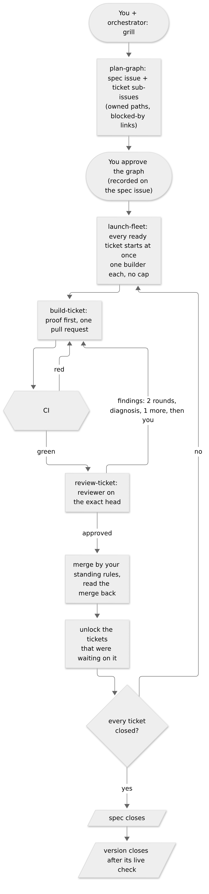

# How fleets work (OpenWiz 0.0.5)

**Status: being grilled (2026-10-30).** Terms are in [GLOSSARY.md](../GLOSSARY.md); decisions in [docs/adr/](adr/).

New here? The [install guide](install.md) takes you from one line to your first fleet.

In 0.0.5 a fleet runs on **skills** (Markdown files any agent can follow) plus GitHub and CloudRoom. No OpenWiz code holds fleet state yet: that is 0.0.6.

## Who does what

| Who | Does | Never |
| --- | --- | --- |
| **You** | Answer the grill, approve each plan graph, decide anything live or published | Talk to builders or reviewers |
| **Orchestrator** (one per project) | Grills, plans, launches fleets, routes reviews, merges by your standing rules | Builds or reviews |
| **Builder** (one per ticket) | Builds its ticket on its own branch, proof first, opens one pull request | Reviews, merges, or spawns other agents |
| **Reviewer** (one per pull request, a different model family) | Reviews the exact head, approves or lists findings | Edits |

## Where everything lives

| Thing | Lives in |
| --- | --- |
| Version | a GitHub milestone |
| Spec | a GitHub issue in that milestone; its body is the spec |
| Ticket | a sub-issue of the spec, with its owned paths and "blocked by" links |
| Your approval of a plan graph | a comment on the spec issue, quoting you, naming the graph's revision |
| A ticket's work | its pull request, its CI run and its review |
| Agents | CloudRoom threads |
| Words and decisions | `GLOSSARY.md` and `docs/adr/` |
| The orchestrator's notes between sessions | a handoff file in the repository |

## The flow, for one spec



(Source: [fleets-flow.mmd](fleets-flow.mmd).)

1. **grill:** the orchestrator and you settle the design in rounds; answers are saved to the glossary and ADRs.
2. **plan-graph:** the orchestrator writes the spec issue and its tickets, with owned paths and blocking links; you review them together.
3. **You approve the graph.** The orchestrator records your words on the spec issue.
4. **launch-fleet:** every ticket whose blockers have all merged starts at once, one builder each. No cap.
5. **build-ticket:** each builder works proof first and opens one pull request; CI runs.
6. **review-ticket:** a reviewer checks the exact head. Findings go back to the builder; each finding gets 2 rounds, then the orchestrator's diagnosis, then 1 more, then you.
7. **Merge** by your standing rules, then **read the merge back** from GitHub. The ticket closes.
8. **Unlock:** tickets that were waiting on it start (back to step 4). When every ticket is closed, the spec closes; until then the fleet keeps working its frontier.
9. **The version** closes when its milestone is done and its live check has passed.

## Many fleets at once

Every approved spec is its own fleet, running the same flow at the same time. One orchestrator runs all of a project's fleets; another project has its own orchestrator. In 0.0.5 the orchestrator tells you where each fleet stands; in 0.0.6 OpenWiz shows it.

## The skills in 0.0.5

`grill`, `plan-graph`, `launch-fleet`, `build-ticket`, `review-ticket`, `handoff`, `setup` and `triage`. Each is grilled with Jake before it is written, as one Markdown file he can read.

**Later:** the fleet view (0.0.6, as OpenWiz code); helper swarms for builders and reviewers, sized by how hard a pull request is (0.0.7, from the difficulty each 0.0.5 and 0.0.6 run records); wayfind (0.0.7).

## What 0.0.6 changes

OpenWiz itself takes over launching, watching and fleet state, so nothing depends on one orchestrator's memory, and shows every fleet in one view: what is moving, what is blocked, what needs you. 0.0.5 is accepted by planning and building 0.0.6 with these skills.

### The 0.0.6 tick and loop check

`openwiz fleet tick --dry-run --json` reads the repository's fleets, the rules
from `docs/agents/fleet.md` on its default branch, and the runner's start records.
It prints the planned actions and their rules, without taking locks or making
writes. `openwiz fleet tick --json` carries out those actions through the GitHub
and CloudRoom adapters and prints each outcome. Its JSON actions also include
pending-start recoveries, with their actual outcomes, before the actions planned
from refreshed inputs. Recovery rechecks authority and reconciles a pending
start before any retry; a dry run leaves it unresolved as a `look` and starts
nothing. Without `--json`, tick prints
only judgment items (`wake` and `needs_you`); an ordinary mechanical tick is
silent. An action that did not end `done` (a `refused`, `failed` or `uncertain`
outcome) always prints one diagnostic line, including a recovery that already
ran and failed, so a write that keeps failing is never mistaken for a quiet
tick. An unread global input exits nonzero with no
JSON document. An unread fleet or ticket becomes a `look`, and grants no
authority to start or merge.

The loop's check sandbox cannot use `room-cli` (#116). Its check script runs
**only** this command, from the project's repository, with its normal `gh` login:

```sh
#!/bin/sh
set -eu
exec openwiz fleet due --github-only
```

Due reads GitHub only: it neither opens OpenWiz's state directory nor calls
CloudRoom or makes writes. It prints one line per candidate, prints nothing
when GitHub proves there is no candidate, and exits nonzero on a failed global
read. A candidate is possible work, including an archive whose optional start
comment is missing; it is not permission to act. False positives are expected
when GitHub cannot settle a CloudRoom fact: a closed ticket with no agent comment
cannot be distinguished from a local start whose optional comment failed. The
conservative check wakes for both. If agents were archived but their final
`launch-fleet: archived` record failed, tick retries that record without
archiving the threads again. The agent the loop wakes runs
`openwiz fleet tick` in a thread sandbox, where `room-cli` works, and handles
any judgment lines. Due does not itself run tick or create a loop. It reads each inventory once
and groups one paginated repository-wide comment snapshot. Before a start,
a merge or a release, tick re-reads the relevant fleet's current approvals and
records. Independent merge-containment reads use the existing four-read cap;
the run budget stays 30 seconds.

Keep that runner's sandbox and `OPENWIZ_STATE_DIR` stable across ticks. The
start record, saved before creation, binds an op id and the returned thread id
to each builder or review; titles do not establish identity. Pending starts
are reconciled through B4 before an authorized retry. An uncertain start is a
`look`, never a second start. CloudRoom can reach only the descendants its
owning thread started: a tell or archive aimed at another owner's agent may
fail and stays due (ADR 0011). Do not replace the runner with a fresh sandbox
and an empty start store.

Give the runner `OPENWIZ_ORCHESTRATOR_THREAD_ID` for its Needs you messages.
A missing or invalid destination fails that notification, leaves its final
record unwritten, and keeps it due. A failed or interrupted multi-write action
also has no completion record; the next tick reads back what already happened
before completing it. A send repeated after an interruption may reach its
recipient twice, as the tick contract specifies.

Only a current approved plan and its exact-head reviewer approval, confirmed
in the reviewer's output, plus CI on the same head and unchanged base, permit
an ADR 0008 merge. Every merge cites that rule, approval and verdict. Release
lines and live checks remain the user's. CI whose check set or base provenance
cannot be established is unread, not green. Use the JSON outcomes to inspect
refusals and uncertain writes; fixture tests do not establish that those calls
work live. The new writes' live check is B6 (#122).
