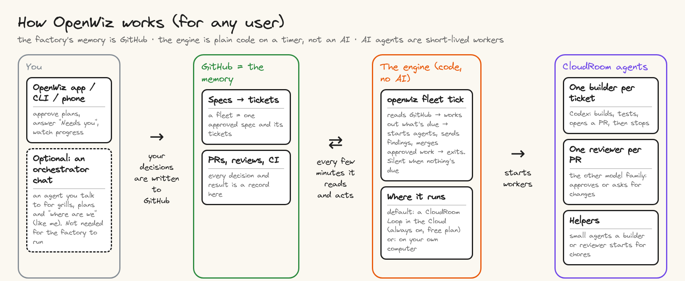

# How OpenWiz works

The picture still shows the retired `openwiz fleet tick` engine; the text below is current.

OpenWiz runs a software factory on GitHub, with your agents on CloudRoom, this computer, boat.dev or another host with a driver under `adapters/`. Four parts:

- **You** use the OpenWiz app, CLI or phone to approve plans, answer "Needs you" and watch progress. An orchestrator chat (an agent you talk to for grills, plans and "where are we") is optional: the factory runs without one.
- **GitHub is the memory.** A fleet is one approved spec and its tickets; every decision and result is a record on GitHub (issues, pull requests, reviews, CI).
- **The fleet runs in short wakes, not a long-running engine.** Each spec has its own loop. Each due run is one fresh, finite wake of an agent following the `launch-fleet` skill: it reads GitHub, works out what is due, starts builders and reviewers, sends review findings and CI failures to builders, merges approved work, records each outcome on GitHub, and ends. With CloudRoom the loop is a CloudRoom Loop; without CloudRoom, `launch-fleet` runs in-session on this computer (`session.py run`) or through a local heartbeat that checks GitHub from this computer every ten minutes. The executing `openwiz fleet tick` is retired: `openwiz fleet tick --dry-run` only prints the plan.
- **Agents are short-lived workers:** one builder per ticket (it builds, tests, opens a pull request, then stops), one reviewer per pull request from the other model family, and small helpers a builder or reviewer starts for chores.

There is no long-running orchestrator per fleet. Each wake re-reads everything from GitHub, so nothing is lost if a thread stops, and agents exist only while there is work.

**How OpenWiz talks to them:** to CloudRoom only through `room-cli`, and only with the commands in its allowlist (`crates/adapters/cloudroom/src/allowlist.rs`): `room-cli --version`, listing and reading threads, projects and machines, `thread tell` to send, `thread spawn` to start one, `thread archive`, CloudRoom's status and a thread's workspace, and listing, creating, updating, pausing and resuming loops; to GitHub through `gh` and OpenWiz's GitHub App. The tests run a fake `room-cli` and never touch a real account.

Source: Jake, 2026-11-05: document the factory architecture described here ([private record](https://github.com/jparker2006/ClosedWiz/issues/1276#issuecomment-6704797460)).
