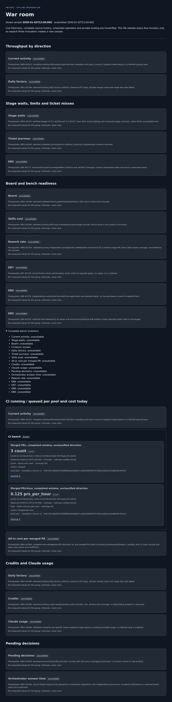

# War room

**Last good render:** 2030-01-02T12:03:00Z (UTC), sample 2030-01-02T12:00:00Z, 1 saved samples.

Published by `.github/workflows/war-room.yml` on `main`; a failed test, read or render publishes nothing, so this page keeps its last good state and time. Live sources, five-minute operation and complete history remain Unverified.

<picture><source media="(max-width: 700px)" srcset="war-room-phone.png"></picture>

On a phone, [the one-column picture](war-room-phone.png).

## Benches

Every bench in the saved sample, with its state and how many of its values are measured. Unknown is never zero; the picture names each prerequisite.

| Bench | State | Measured |
| --- | --- | --- |
| Current activity | unavailable | 0 of 0 |
| Stage waits | unavailable | 0 of 0 |
| Board | unavailable | 0 of 0 |
| CI bench | known | 2 of 2 |
| Daily factory | unavailable | 0 of 0 |
| Ticket journeys | unavailable | 0 of 0 |
| Skills eval | unavailable | 0 of 0 |
| All-in cost per merged PR | unavailable | 0 of 0 |
| Credits | unavailable | 0 of 0 |
| Claude usage | unavailable | 0 of 0 |
| Pending decisions | unavailable | 0 of 0 |
| Orchestrator answer time | unavailable | 0 of 0 |
| Rework rate | unavailable | 0 of 0 |
| EB6 | unavailable | 0 of 0 |
| EB7 | unavailable | 0 of 0 |
| EB8 | unavailable | 0 of 0 |
| EB9 | unavailable | 0 of 0 |

Saved samples are in `samples/`, one per five-minute boundary sampled; a boundary not sampled stays absent.
